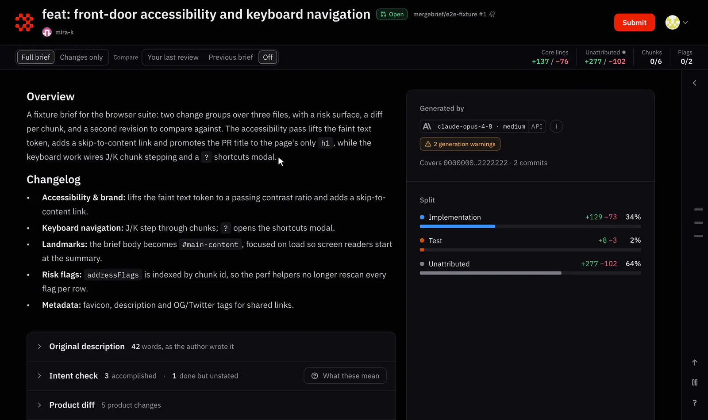

<p align="center">
  <a href="https://mergebrief.com">
    
  </a>
</p>

<h1 align="center">MergeBrief</h1>

<p align="center">The self-hosted comprehension layer for code review.</p>

<p align="center">
  <a href="https://mergebrief.com"><strong>Website</strong></a> ·
  <a href="https://demo.mergebrief.com">Demo</a> ·
  <a href="https://docs.mergebrief.com">Docs</a> ·
  <a href="./docs/self-host/README.md">Self-host</a> ·
  <a href="./docs/self-host/cli.md">CLI</a>
</p>

<p align="center">
  <a href="https://demo.mergebrief.com">
    
  </a>
</p>

MergeBrief turns a GitHub pull request from a flat file list into a **brief**: the changes regrouped into categorized Change-groups, each with a plain-language summary and the facts worth a closer look.

It doesn't hunt for bugs, score the PR or approve it. It organizes the review so a person can read the change as a story and answer for the merge.

## Overview

- **A story, not a file list.** Change-groups in a reading order, foundations first, each with a Category from a fixed vocabulary.
- **Risk Surface.** Facts per chunk such as `touches-auth` or `no-tests`, each checkable in seconds. Never a verdict.
- **Delta Brief.** After new pushes, see only what changed since your last review, with the comments each change addresses.
- **Intent check.** What the PR and its ticket say, compared with what the diff does.
- **Receipt.** A record of what you read and how you handled each flag.
- **Your infrastructure.** Self-hosted, your own model key, no telemetry, no per-seat cost. Your code is never stored; the diff is sent to the model provider you choose.

## Self-host

MergeBrief runs as one Docker Compose release next to your own GitHub App and your own model key. You need:

- Docker with Compose.
- A public HTTPS origin GitHub can reach: a domain on a server, or a tunnel on your own machine.
- A GitHub App you register for your instance: [GitHub App setup](./docs/self-host/github-app.md).
- A model key, for example from Anthropic, OpenAI or OpenRouter: [model backends](./docs/self-host/generators.md) lists every option.

The [quick start](./docs/self-host/README.md#quick-start) takes you from an empty folder to a brief on a real pull request, and the [self-host guide](./docs/self-host/README.md) covers sizing, hardening and operations.

A coding agent can run the server steps for you if you point it at the [self-host guide](./docs/self-host/README.md). Register the GitHub App, set the DNS record and paste the secrets into `.env` yourself, so no credential passes through the agent.

## CLI

The same review loop from the terminal, for people and agents:

```bash
npm i -g mergebrief
```

To let a coding agent review through MergeBrief, install the [skill](./skills/mergebrief/SKILL.md):

```bash
npx skills add idan91/mergebrief --skill mergebrief
```

The [CLI guide](./docs/self-host/cli.md) covers tokens and setup.

## Guides

- [Self-host setup](./docs/self-host/compose.md)
- [GitHub App setup](./docs/self-host/github-app.md)
- [Configuration](./docs/self-host/configuration.md)
- [Model backends](./docs/self-host/generators.md)
- [Per-repo config](./docs/repo-config/README.md)
- [Upgrades](./docs/self-host/upgrade.md)
- [Backup and restore](./docs/self-host/backup-restore.md)
- [Security model](./docs/self-host/security-model.md)
- [How MergeBrief works](./docs/architecture.md)
- [Glossary](./docs/glossary.md)

[docs.mergebrief.com](https://docs.mergebrief.com) has the full list.

## Contributing

MergeBrief is pre-1.0. Read [CONTRIBUTING.md](./CONTRIBUTING.md) before you open a pull request; it also covers the local dev setup. Report vulnerabilities privately, as [SECURITY.md](./SECURITY.md) describes.

## License

[FSL-1.1-ALv2](./LICENSE). Use, self-host, modify and fork it; don't offer it as a competing commercial product. Each release becomes Apache-2.0 two years after it ships.
